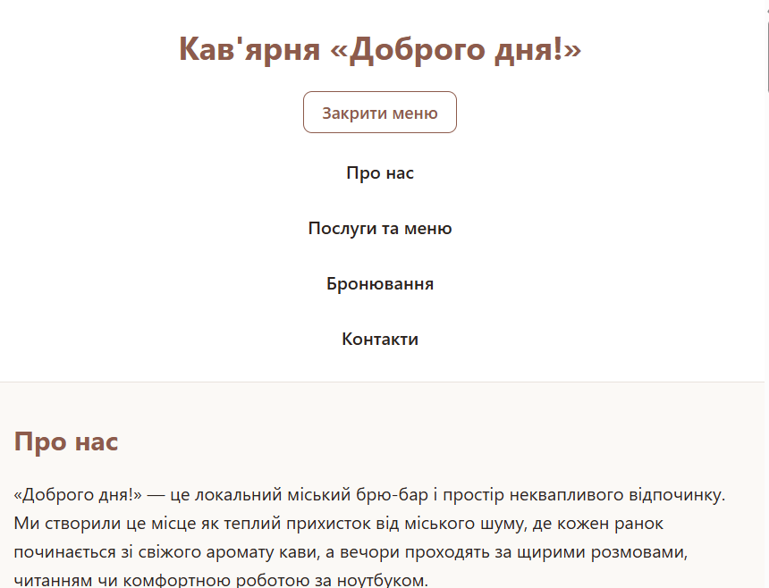
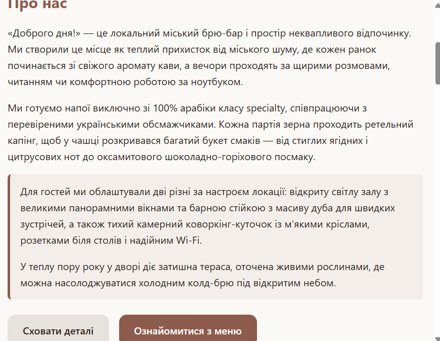
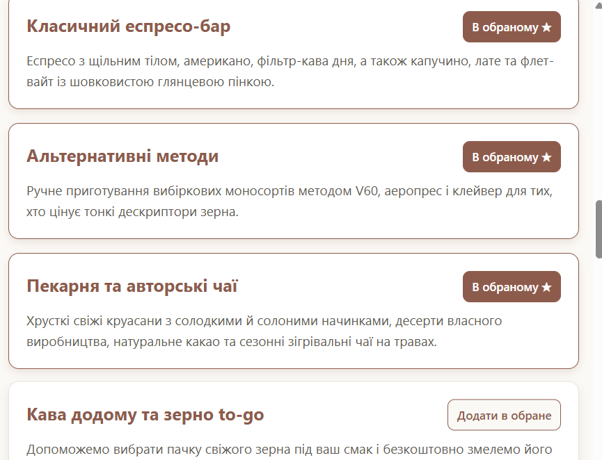

## Лабораторна робота №5

**Тема:** Основи JavaScript. Взаємодія з DOM та подіями.
**Мета:** Навчитися підключати зовнішній JavaScript-файл, знаходити наявні HTML-елементи, реагувати на дії користувача та змінювати класи й текстовий вміст елементів. Додати до наскрізного сайту інтерактивні можливості.

### Реалізовані сценарії інтерактивності:

1. **Мобільне меню навігації:** відкриття та закриття списку посилань на мобільних пристроях з перемиканням класу .is-open, тексту кнопки та атрибута aria-expanded.
2. **Розкриття додаткового опису («Показати більше»):** плавне керування видимістю додаткового блоку інформації за допомогою класу .is-hidden з динамічним оновленням тексту кнопки (Показати більше / Сховати деталі) та стану aria-expanded.
3. **Кнопка «В обране» на картках меню:** незалежний вибір улюблених позицій у меню з додаванням класу .is-active, зміною стилю картки, оновленням тексту на «В обраному ★» та перемиканням стану aria-pressed.

### Використані DOM-методи та події:

- document.querySelector() та document.querySelectorAll() — пошук необхідних елементів у дереві DOM.
- addEventListener('click', ...) — реєстрація обробників подій кліку мишею/клавіатурою.
- element.classList.toggle() — безпечне перемикання CSS-класів стану (.is-open, .is-hidden, .is-active) без прямого запису inline-стилів.
- element.textContent — оновлення текстового вмісту кнопок відповідно до поточного стану інтерфейсу.
- element.setAttribute() — динамічне керування атрибутами доступності (aria-expanded, aria-pressed) для скрінрідерів.

---

### Знімки екрана реалізованих станів

#### 1. Мобільне навігаційне меню (активний стан is-open)

#### 2. Розкриття додаткового блоку опису (стан без класу is-hidden)

#### 3. Додавання карток до списку обраного (стан is-active та aria-pressed="true")

---

### Посилання на Pull Request

- **Pull Request:** [lab-5-js-dom PR](https://github.com/dimontttt/WEB_labs_2026/pull/7)

### Висновок

Під час виконання лабораторної роботи було опановано базові механізми взаємодії JavaScript з Document Object Model (DOM). Реалізовано 3 інтерактивні сценарії поведінки сторінки без використання сторонніх бібліотек чи генерації HTML із масивів даних. Усі візуальні зміни реалізовано через керування класами стану в CSS та оновлення семантичних ARIA-атрибутів доступності, що забезпечує коректну роботу сайту на мобільних пристроях і доступність із клавіатури.
