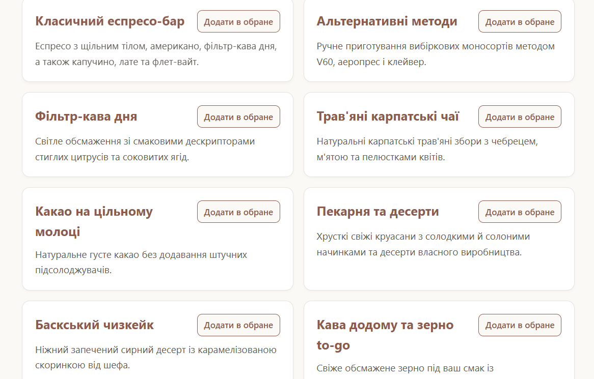
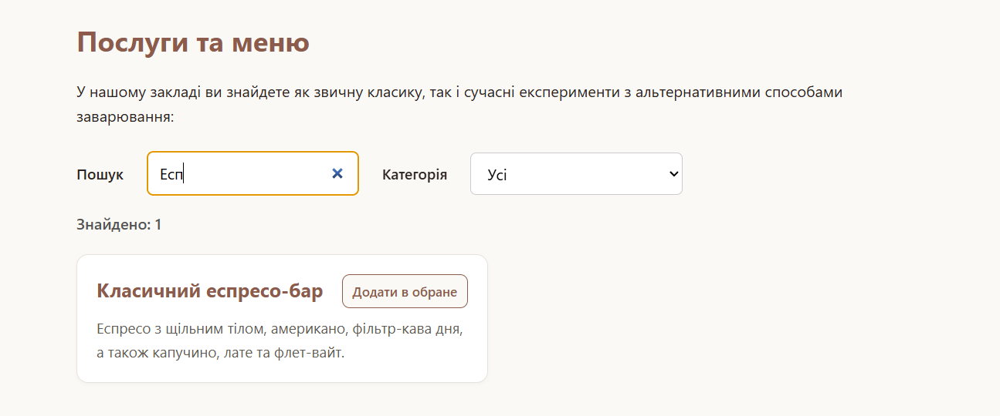
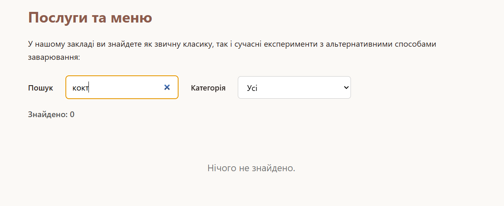

# Лабораторна робота № 6. Дані та динамічне формування DOM засобами JavaScript

- **Тема:** Масиви та об’єкти JavaScript. Динамічне формування контенту, пошук і фільтрація даних.
- **Мета:** Навчитися описувати предметні дані масивом об’єктів, перетворювати дані на HTML-картки, оновлювати DOM і реалізовувати пошук та фільтрацію без перезавантаження сторінки.

## Інструкція для локального запуску

1. Склонувати репозиторій або завантажити файли проєкту.
2. Відкрити файл `index.html` у браузері (або запустити через Live Server у VS Code).

## Опис структури даних

Дані карток меню винесені в масив об'єктів `items`. Кожен об'єкт містить такі властивості:

- `id` (Number) — унікальний ідентифікатор позиції;
- `title` (String) — назва напою або десерту;
- `category` (String) — ідентифікатор категорії (`coffee`, `tea`, `pastry`);
- `description` (String) — опис позиції;
- `image` (String) — шлях до зображення.

Використані категорії:

- `coffee` — Кава;
- `tea` — Чай та какао;
- `pastry` — Пекарня та десерти.

## Опис реалізованих функцій

- `createCard(item)` — генерує HTML-розмітку однієї картки на основі переданого об'єкта за допомогою шаблонних рядків.
- `renderItems(itemsToRender)` — трансформує масив об'єктів у розмітку за допомогою `.map()` та `.join("")`, оновлює лічильник результатів та відображає або ховає блок `#empty-message`.
- `applyFilters()` — зчитує пошуковий запит і обрану категорію, здійснює комбіновану фільтрацію за допомогою `.filter()` без урахування регістру (`.toLowerCase()`) і передає відфільтровані елементи у `renderItems()`.
- `initFavoriteButtons()` — вішає обробники подій на кнопки додавання в обране для динамічно створених карток.

## Перевірені сценарії

1. Первинне завантаження сторінки з відображенням усіх 8 карток.
2. Пошук за назвою та описом без урахування регістру.
3. Фільтрація карток за категоріями зі списку.
4. Одночасне застосування пошуку та вибору категорії.
5. Повернення до повного списку при скиданні фільтрів.
6. Відображення повідомлення «Нічого не знайдено.» у разі відсутності результатів.
7. Відсутність помилок у Console DevTools.

## Скриншоти виконання

1. Усі картки: 
2. Результат пошуку: 
3. Порожній результат: 

## Посилання на Pull Request

- **Pull Request:** [lab-6-dynamic-dom PR]()
