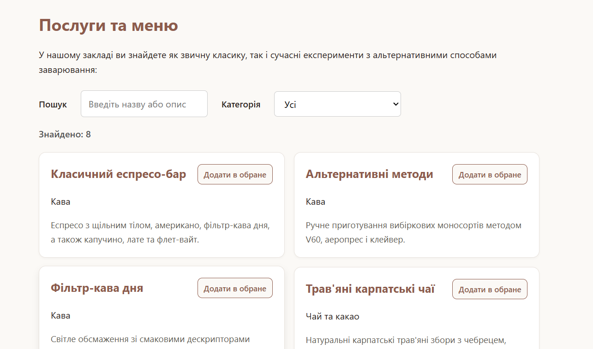
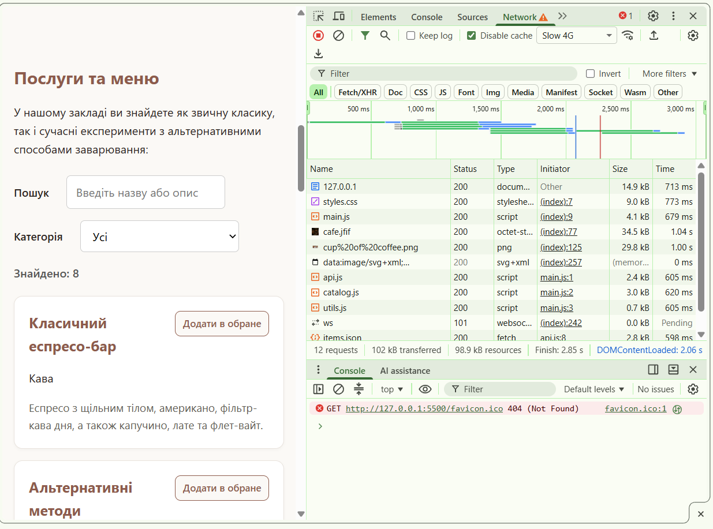
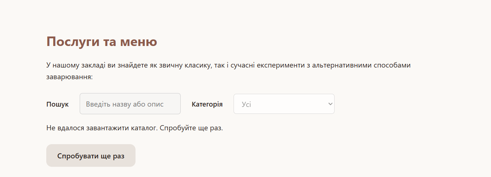

# Лабораторна робота № 7. Модульний каталог та асинхронне завантаження даних

- **Тема:** ES Modules, async/await, замикання та чисті функції у JavaScript.
- **Мета:** Розвинути каталог із лабораторної № 6: розділити код на модулі, завантажувати предметні дані з JSON через `fetch()`, обробляти помилки та використати замикання для відкладеного пошуку.

---

## 1. Інструкція для локального запуску

1. Склонувати репозиторій або завантажити файли проєкту:
   ```bash
   git clone <URL_репозиторію>
   ```
2. Відкрити кореневу папку проєкту у **VS Code**.
3. Запустити локальний сервер HTTP (наприклад, розширення **Live Server**):
   - Клікніть правою кнопкою миші на файл `index.html` $\rightarrow$ виберіть **«Open with Live Server»**.
   - Або натисніть кнопку **«Go Live»** у нижньому рядку стану VS Code.
4. Проєкт відкриється в браузері за адресою `http://localhost:5500/...` (або `http://127.0.0.1:5500/...`).  
   _Примітка: відкриття файлу безпосередньо через протокол `file://` блокується браузером через політику CORS для ES-модулів._

---

## 2. Структура модулів та файлів

- **`index.html`** — розмітка сторінки з підключенням вхідного модуля `<script type="module" src="js/main.js"></script>`, контейнером карток `#item-grid`, статусом `#load-status`, помилкою `#load-error` та кнопкою повтору `#retry-load`.
- **`css/styles.css`** — стилізація карток меню, адаптивної сітки, фільтрів, станів помилки та завантаження.
- **`data/items.json`** — файл структурованих даних у форматі JSON (8 позицій, 3 категорії).
- **`js/api.js`** — модуль взаємодії з даними:
  - Формує URL відносно модуля за допомогою `import.meta.url`.
  - Виконує асинхронний запит `fetch()`.
  - Перевіряє статус відповіді через `response.ok`.
  - Здійснює валідацію: перевіряє типи даних, непорожні рядки, унікальність та цілочисельність `id` ($> 0$), допустимість категорій.
- **`js/catalog.js`** — модуль представлення та фільтрації:
  - `filterItems(items, query, category)` — чиста функція фільтрації без побічних ефектів.
  - `renderItems(items, grid, count, empty)` — безпечний рендеринг за допомогою `document.createElement()`, `DocumentFragment`, `replaceChildren()` та `textContent` (без використання небезпечного `innerHTML`).
  - Підтримка інтерактивного стану кнопки «Додати в обране» (`aria-pressed`).
- **`js/utils.js`** — допоміжні інструменти:
  - `debounce(fn, delay)` — функція вищого порядку, що реалізує замикання для відкладеного виконання функції пошуку.
- **`js/main.js`** — головний вхідний модуль:
  - Імпортує модулі `api.js`, `catalog.js`, `utils.js`.
  - Керує станами завантаження (`try/catch/finally`), блокуванням полів вводу та доступністю (`aria-busy`, `role="status"`, `role="alert"`).
  - Реєструє події з оптимізованим `debounce` для поля пошуку.

---

## 3. Приклад структури запису JSON

```json
[
  {
    "id": 1,
    "title": "Класичний еспресо-бар",
    "category": "coffee",
    "description": "Еспресо з щільним тілом, американо, фільтр-кава дня, а також капучино, лате та флет-вайт.",
    "image": "images/cup of coffee.png"
  }
]
```

---

## 4. Пояснення ключових концепцій

- **`async/await`:** Синтаксичний цукор над промісами (Promises). Дозволяє писати асинхронний код (виклик `fetch()`, парсинг `response.json()`) у послідовному, зручному для читання синхронному стилі та коректно перехоплювати будь-які мережеві або програмні помилки за допомогою блоку `try...catch...finally`.
- **Чиста функція (`filterItems`):** Функція, яка за однакових аргументів завжди повертає однаковий результат і не створює побічних ефектів (не змінює DOM, не мутує вхідні масиви або об'єкти, не зчитує змінні поза межами своєї області видимості). Це спрощує тестування та повторне використання коду.
- **Замикання (`debounce`):** Механізм JavaScript, завдяки якому функція зберігає доступ до лексичного оточення (змінної `timerId`), в якому вона була створена, навіть після завершення виконання зовнішньої функції. При кожному новому натисканні клавіші таймер очищується через `clearTimeout(timerId)` і перезапускається заново. Лише після паузи в 300 мс спрацьовує колбек-функція.

---

## 5. Результати 10 перевірок функціональності

1. **Завантаження даних:** При відкритті через локальний сервер завантажуються всі 8 карток; на вкладці _Network_ DevTools зафіксовано успішний HTTP-статус `200` для `items.json`.
2. **Пошук:** Текстовий пошук працює за назвою та описом без урахування регістру; початкові та кінцеві пробіли відсікаються (`trim()`).
3. **Одночасна фільтрація:** Пошуковий рядок і випадаючий список категорій працюють сумісно. Вибір опції «Усі» та очищення рядка пошуку повертає всі 8 позицій.
4. **Порожній результат:** Якщо збігів немає, відображається текст «Нічого не знайдено.», лічильник показує `0`, сітка порожня.
5. **Стан завантаження:** Під час увімкненого обмеження швидкості (_Slow 4G_ / _Slow 3G_) та вимкненого кешу видно статус «Завантаження…», а елементи введення стають заблокованими (`disabled`).
6. **Обробка помилки завантаження:** При зміні імені файлу `items.json` з'являється червоне повідомлення про помилку та кнопка «Спробувати ще раз».
7. **Повторна спроба:** Після відновлення назви файлу та кліку на «Спробувати ще раз» дані завантажуються коректно без перезавантаження сторінки або дублювання карток.
8. **Валідація структури:** Порожній масив `[]` відображає порожній стан; у разі пошкодження структури файлу або невалідних полів (дубльований `id`, некоректні типи) модуль `api.js` викидає помилку, що перехоплюється інтерфейсом.
9. **Затримка (Debounce):** Швидкий набір тексту відкладає фільтрацію на 300 мс після завершення введення; вибір категорії в селекті оновлює інтерфейс миттєво.
10. **Доступність і DevTools:** Забезпечено навігацію з клавіатури, наявні семантичні атрибути `aria-busy`, `role="status"`, `role="alert"`, `aria-live`. У консолі браузера відсутні помилки виконання коду.

---

## 6. Скриншоти виконання

1. **Успішне завантаження каталогу:**  
   

2. **Стан завантаження (емуляція повільної мережі):**  
   

3. **Стан помилки та кнопка повторної спроби:**  
   

4. **Порожній результат пошуку:**  
   

---

## 7. Посилання на Pull Request

- **Pull Request:** [lab-7-async-modules PR]()
