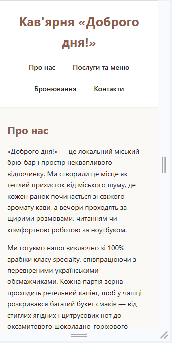
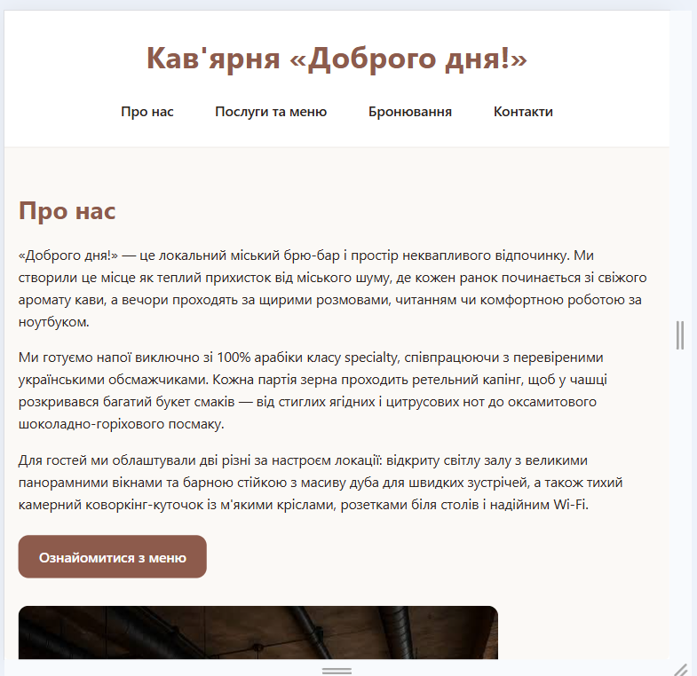
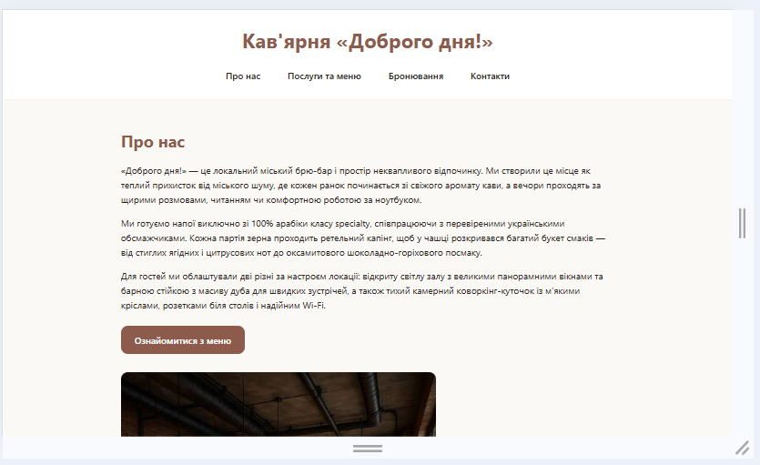

# Лабораторна робота №4. Препроцесор Sass та Mobile-First адаптивність

## Тема, мета та опис проєкту

- **Тема:** Організація модульної структури стилів через Dart Sass, налаштування компіляції та створення адаптивного макета за принципом Mobile-First.
- **Мета:** Навчитися працювати з препроцесором Sass, налаштувати збірку через npm-скрипти, розбити стилі на окремі файли за допомогою `@use`, реалізувати адаптивність Mobile-First та написати свій параметризований міксин для медіа-запитів.
- **Опис проєкту:** Продовження роботи над сайтом кав'ярні «Доброго дня!». Перевів звичайний CSS на модульний SCSS, налаштував автоматичну компіляцію у фоновому режимі та зробив інтерфейс зручним для перегляду як зі смартфона, так і з планшета чи монітора без горизонтального скролу.

## Реалізовані зміни

1. **Налаштування Dart Sass:** Ініціалізував `package.json`, встановив компілятор `sass` у dev-залежності та прописав дві команди: `build:css` для разової збірки без source-map і `watch:css` для автоматичного оновлення при збереженні файлів. Папку `node_modules/` додав у `.gitignore`.
2. **Модульна структура файлів:** Створив папку `scss/` і розбив код на частини: у `_variables.scss` виніс кольори, радіуси, відступи та точки переходу (`$bp-tablet: 48rem`, `$bp-desktop: 64rem`), у `_mixins.scss` написав міксин `respond-from`, а в `main.scss` підключив їх через сучасний `@use` з префіксами `v` та `m`.
3. **Підхід Mobile-First:** Спочатку зверстав сторінку під невеликий екран смартфона: шапка стоїть стовпчиком, меню переноситься рядками (`flex-wrap: wrap`), картки йдуть строго в одну колонку, а кнопка у формі займає всю ширину екрана.
4. **Міксини та адаптивність:** Через міксин `@include m.respond-from(v.$bp-tablet)` зробив так, щоб на планшетах (від 768px) картки ставали у дві колонки, посилання в меню вишиковувалися в одну лінію, а кнопка бронювання поверталася до звичайного розміру.
5. **Доступність і центрування:** Обмежив ширину основного контенту до `900px` по центру екрана. Для посилань, полів форми та кнопок залишив чіткий синій контур при натисканні клавіші `Tab` (`:focus-visible`), щоб сторінкою було зручно користуватися без мишки.

## Структура проєкту

- css/
  - styles.css
- images/
  - cafe.jfif
  - cup of coffee.png
  - screen-360px.png
  - screen-768px.png
  - screen-1280px.png
- scss/
  - \_mixins.scss
  - \_variables.scss
  - main.scss
- .gitignore
- index.html
- package-lock.json
- package.json
- README.md

## Команди встановлення залежностей і компіляції

- **Встановлення Sass у проєкт:**
  `npm install --save-dev sass`
- **Разова збірка стилів:**
  `npm run build:css`
- **Автоматична збірка при зміні файлів:**
  `npm run watch:css`

## Опис Mobile-First підходу та точок переходу

Верстку робив за принципом Mobile-First: спочатку прописав базові стилі для смартфона (від 360 px), а потім через свій міксин додав розширення для ширших екранів:

- **Мобільні екрани (< 768px):** елементи шапки стоять вертикально, пункти меню переносяться при потребі завдяки `flex-wrap: wrap`, усі картки йдуть в одну колонку, а кнопку та поля форми розтягнув на всю ширину, щоб по них було зручно тапати пальцем.
- **Планшет (брейкпоінт 768px / 48rem):** підключив міксин `respond-from`, після чого сітка карток меню автоматично перестрибує у дві рівні колонки, навігація вирівнюється в один охайний рядок, а кнопка у формі стає звичайної ширини (`width: auto`).
- **Десктоп (від 1024px):** зафіксував загальний контейнер сайту на `max-width: 900px` з автоматичними відступами по боках, щоб контент гарно тримався по центру монітора й текст не розповзався на всю ширину.

## Результати перевірки: відсутність горизонтального скролу, коректність форми й навігації

Під час тестування сайту в DevTools перевірив основні моменти:

- **Горизонтальний скрол:** його немає на жодному з екранів, усе поміщається в екран 360 px без зсувів завдяки `box-sizing: border-box`, картинкам з `max-width: 100%` та `overflow-x: hidden` на `body`.
- **Навігація:** меню працює адекватно — на телефоні посилання м'яко переносяться рядками і не вилазять за краї, а на планшеті й ПК стають в один ряд.
- **Форма бронювання:** на мобілці інпути великі та зручні для вводу, на десктопі форма має охайну фіксовану ширину без деформацій.
- **Доступність (a11y):** пройшовся по сторінці клавішею `Tab` — навколо активних кнопок, інпутів та посилань з'являється чітка синя рамка (`outline` через `:focus-visible`), тож сайтом зручно користуватися без мишки.

## Результат тестування

### 1. Мобільний вигляд (360px)

### 2. Планшетний вигляд (768px)

### 3. Десктопний вигляд (1280px)

## Посилання та висновок

- **Pull Request:** [lab-4-scss-responsive PR](https://github.com/dimontttt/WEB_labs_2026/pull/6)
- **Висновок:** У цій лабораторній розібрався, як працювати з препроцесором Dart Sass та налаштувати його збірку через npm-команди. Розділив стилі по окремих partial-файлах, спробував директиву `@use` замість застарілого імпорту та написав міксин для медіа-запитів. Зробив сторінку адаптивною за схемою Mobile-First: перевірив у DevTools на ширинах 360, 768 і 1280 пікселів — блоки перебудовуються як треба, форма залишається зручною, а горизонтальна смуга прокрутки ніде не вилазить.
